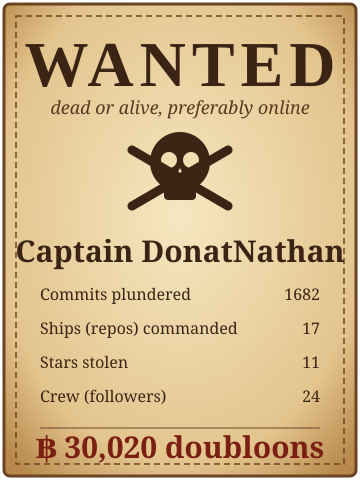

 

  

  
  &nbsp;&nbsp;&nbsp;
  
  &nbsp;&nbsp;&nbsp;
  

## 📜 Captain's Log

<!-- CAPTAINS-LOG:START -->
> 📜 **Captain's Log, day 1,882 at sea** (25 November 2026)
>
> 🌊 Spyglass pointed at **Saint-Malo**: overcast ☁️, 10°C, winds at 26 km/h.
>
> 🦜 *"Not all treasure is silver and gold, mate."*
<!-- CAPTAINS-LOG:END -->

## 💰 Most Wanted

  

## 🐍 Here Be Serpents

*A sea serpent lurks in these waters, devouring every commit it finds...*

<picture>
  <source media="(prefers-color-scheme: dark)" srcset="https://raw.githubusercontent.com/DonatNathan/DonatNathan/output/sea-serpent-dark.svg" />
  
</picture>

## 👋 See you on the ocean

If you like **programming** and **pirates**, follow me for many **adventures**.

  

