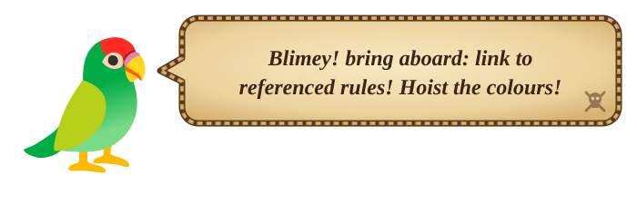
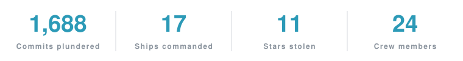
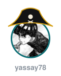
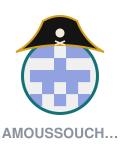
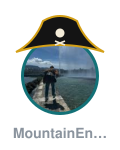
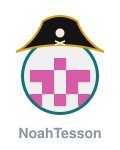

<!-- HEADER:START -->
<h2 align="center">⚓ Captain Donat · Day 1,882 at sea</h2>
 
<!-- HEADER:END -->

  

  
  &nbsp;&nbsp;&nbsp;
  
  &nbsp;&nbsp;&nbsp;
  

<!-- CAPTAINS-LOG:START -->
   

<h3 align="center">🗺️ Last seen plundering <a href="https://github.com/DonatNathan/foundry-coding-style">foundry-coding-style</a></h3>

1 day ago

🦜 The parrot overheard <code>add: link to referenced rules</code> and won't stop repeating it.

   
<!-- CAPTAINS-LOG:END -->

## 🏴‍☠️ Ship's Ledger

<!-- LEDGER:START -->

<!-- LEDGER:END -->

## 🦜 Latest Recruits

*Fresh faces aboard, welcome to the crew!*

<!-- RECRUITS:START -->

  
  
  
  
  
  
  
  

<!-- RECRUITS:END -->

## 🐍 Here Be Serpents

*A sea serpent lurks in these waters, devouring every commit it finds...*

<picture>
  <source media="(prefers-color-scheme: dark)" srcset="https://raw.githubusercontent.com/DonatNathan/DonatNathan/output/sea-serpent-dark.svg" />
  
</picture>

## 🍾 Bottles Washed Ashore

<!-- BOTTLES:START -->
> *No bottles have washed ashore yet... be the first to throw one!*
<!-- BOTTLES:END -->

 

  

